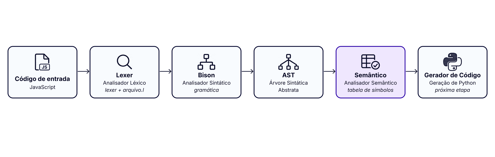

---
hide:
  - navigation
  - toc
---
# Sobre o Projeto

Este projeto tem como foco o desenvolvimento de um compilador para traduzir código-fonte de um subconjunto estruturado e imperativo de **JavaScript (Mini-JS)** diretamente para **Python**. O desenvolvimento é conduzido de forma incremental ao longo de várias sprints, consolidando as principais etapas clássicas da engenharia de compiladores.

## Fluxo de Compilação

O fluxo de compilação especificado para a arquitetura do projeto é composto pelas seguintes tecnologias e etapas:

1. **Analisador Léxico:** Desenvolvido em C utilizando o **Flex**. É responsável por fazer a varredura do código-fonte em JavaScript, descartando espaços em branco e comentários e convertendo o texto em uma sequência de tokens válidos.
2. **Analisador Sintático:** Implementado em C utilizando o **Bison**. Esta etapa recebe os tokens gerados no processo léxico e valida a estrutura das instruções contra a gramática livre de contexto da linguagem.
3. **Árvore Sintática Abstrata (AST):** Construída pelo Bison durante a própria análise sintática, organiza o programa em uma estrutura de árvore na memória. É a representação intermediária do compilador, usada pelas etapas seguintes.
4. **Analisador Semântico:** Percorre a AST e registra variáveis, funções e parâmetros na **tabela de símbolos**, controlando os escopos (global, função, bloco e `for`). Só é executado quando as fases léxica e sintática terminam sem erros.
5. **Gerador de Código Final (próxima etapa):** Responsável por percorrer a AST validada e emitir o código correspondente em **Python (`.py`)**, devidamente indentado e pronto para execução.
